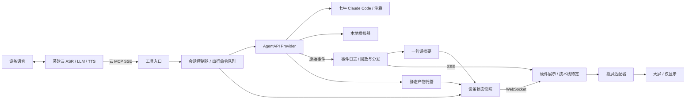

# 架构与初始化范围

以 [issue #6](https://github.com/wwcchh0123/hackathonGO-2026/issues/6) 为依据。旧 issue #1 的本地 Claude Code、权限拦截、多 agent、主动播报不进入本次骨架。

## 模块依赖

- `cmd/control` 组装依赖，业务代码不读取环境变量。正式工程仅使用 Go，硬件实现暂缓。
- `session` 持有 Provider、设备状态、事件日志和产物 Store；控制命令只经一个工作队列执行。
- `agentapi.Provider` 隔离 Create / Send / Interrupt / Status / Stream / Artifacts；Mock 和 HTTP 实现共享上层逻辑。
- `events` 只处理原始事件、日志和订阅，`progress` 从事件提取摘要，不转换、删减上游 JSON。
- `device.State` 发布最新快照：断线后重新发送完整快照。多个展示窗口可以同时观察同一设备。
- `transport` 只处理协议、鉴权和参数；浏览器、MCP 的操作都进入同一控制器。
- 语音与投屏在设备侧；当前只约定协议和职责，不实现或指定硬件技术栈。

## 会话与顺序

1. 云 MCP 工具快速返回受理结果，耗时操作在工作队列执行；受理成功不代表云端任务已完成。
2. 新任务先停止旧任务，再创建新会话、绑定设备、启动事件观察并提交输入。历史持久化由 AgentAPI 负责。
3. send_message 为默认入口：执行时读取 **Provider 当前状态**。idle 直接复用；running 先 interrupt 再轮询直到 idle；无会话 / terminated / 创建失败时新建。不能仅凭 interrupt HTTP 200 或回放的旧 idle 放行。
4. 继续 / 暂停也按原话转交 send_message。创建中的 message / start 均排队；明确换项目由 start_new_project 对应 start action。云端不保留 show / continue / interrupt action 或快照 view 字段。
5. 每个会话一个上游观察器。断线重连后重新回放，按原始事件 ID 去重；不会因为遇到 idle 关闭流。
6. idle 的 end_turn 触发静态产物发布；interrupted、requires_action、retries_exhausted、budget_reached 分别生成对应摘要，不声称任务完成。代际检查防止已经开始下载的旧预览覆盖后续轮次。
7. 新任务取消旧观察器，清空当前结果。设备看到 session id 改变后重建 SSE 订阅。

事件历史与订阅共用一个日志，通知通道只唤醒订阅者读取日志。因此没有“先读历史再订阅”的窗口，也不会因订阅队列太小而静默丢帧。当前日志保留在进程内，适合短时原型；不宣称支持长期无界使用。

## 已串通与待接入

| 模块 | 当前状态 | 后续工作 |
| --- | --- | --- |
| 控制服务与云 MCP | 可运行，官方 SDK 协议测试覆盖 | 灵矽真实云端鉴权与工具选择联调 |
| AgentAPI | Mock 可演示，真实 HTTP 合约有本地假上游测试 | 使用实际 claudecode agent/environment 做云端联调 |
| 设备展示 | 服务端 WebSocket、SSE 与状态/结果地址下发，设备自主切视图；原生 HTML/JS 联调模拟器 | 由硬件团队选择渲染技术，按协议实现，无需对齐 deck-proto |
| 进度摘要 | 确定性规则，不调用额外模型 | 按真实事件丰富摘要，必要时增加模型适配 |
| Web 产物 | 下载 Files API 文件并发布静态网站 | 真实产物目录约定、资源路径与版本联调 |
| 语音 | 核实灵矽 WebSocket 握手、hello 与音频协议，记录接入边界 | 硬件实现麦克风采集、TTS 与播报打断 |
| 设备端 MCP / 投屏 | 约定工具名和入参，核实端侧 MCP 封装 | 硬件实现 MCP 传输、屏幕发现、真实 AirPlay 发送端 |

不把 Linux/ESP32 的 AirPlay 屏幕镜像视为已解决。硬件平台、屏幕兼容性、帧率与音频均需实测；开发时可在电脑全屏打开设备页，手动镜像屏幕验证显示效果。

## 原型取舍

- 单服务、单配置设备、一个当前会话；不引入数据库、账号、租户、计费、HA。
- 进程重启丢失当前绑定和本地事件缓存，需要重新开始任务；`.data/results` 中已经发布的静态文件保留。
- Preview 每次使用随机路径；结果目录禁止列目录。预览 iframe 与响应 CSP 均以 sandbox 隔离，不开放 same-origin、表单和网络请求能力。
- 浏览器控制令牌与 AgentAPI Key 分开。生产需要 TLS，真实模式强制控制令牌，模拟模式默认仅监听 loopback。
- 静态导出只支持 HTML 和同目录的相对资源；每文件上限 10 MiB，最多 100 文件、总计 64 MiB。同名文件按 created_at 保留最新导出。归档、SSR、外部后端服务不在初始范围。
- 退出会取消本地控制工作与流观察；不会删除云端会话或沙箱，仍需按云端生命周期管理其资源。

## 接入前需要补充

1. 目标设备平台和屏幕型号。
2. 硬件侧执行与渲染实现；灵矽协议依据已明确为本机 Xrobot-docs，云端 MCP 的 sse.header 支持 Authorization。
3. AgentAPI 服务地址、可用的 claudecode agent 和 environment；密钥使用环境变量注入。
4. 公网服务和手机预览的最终地址；无此地址时结果链接只用于本机联调。
