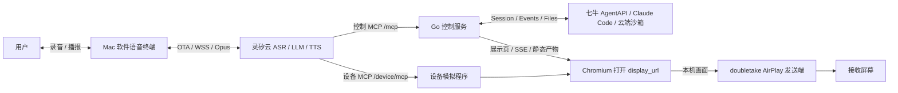

# 当前实现架构

本文描述仓库已实现的模块规格与职责。设计过程与后续 proposal 保留在 [Issue #6](https://github.com/wwcchh0123/hackathonGO-2026/issues/6)、[Issue #18](https://github.com/wwcchh0123/hackathonGO-2026/issues/18) 和 [Issue #25](https://github.com/wwcchh0123/hackathonGO-2026/issues/25)。

## 系统组成

语音终端、控制服务、设备展示是三个独立进程。大屏只显示设备发送的画面；编程在 AgentAPI 沙箱中执行。当前以 Mac 软件设备和设备模拟程序验证，不规定最终硬件平台。

## 模块规格与分工

| 模块 | 输入与输出 | 职责与边界 |
| --- | --- | --- |
| `cmd/control` | 环境变量 → HTTP 服务 | 组装 provider、设备管理器、路由和优雅退出 |
| `cmd/voice` | 启动参数 → 本机 8090 页面 | 组装设备身份、语音桥和生命周期 |
| `cmd/device-display` | 设备配置、MCP 调用 → 浏览器/发送进程 | 打开指定地址、滚动、停止投屏，管理 Chromium 和 AirPlay 子进程 |
| `internal/linx` | 身份文件、OTA、云端 WSS | 身份持久化、绑定检查、获取 token、hello 协商与设备协议 |
| `internal/voice`、`voicecodec` | 浏览器 PCM ↔ 云端 Opus/文字 | 单窗口语音桥、录音/播报及打断；可选原生 libopus |
| `internal/transport/mcp` | 控制 MCP JSON ↔ 领域命令/查询 | 四工具编解码、请求身份，不执行编程业务 |
| `internal/controlplane` | 已鉴权设备调用、管理查询 | 进程内设备注册、按设备路由、只读管理聚合 |
| `internal/session` | 任务引用、需求 → 异步回执/详情 | 唯一编程控制入口；固定发送目标、同任务顺序、未知结果核对、按需观察和预览 |
| `internal/agentapi` | 领域请求 ↔ SDK | Session/Events/Files 上游适配与 Mock；不包含设备展示逻辑 |
| `internal/events` | 原始 JSON → 历史/实时事件 | 保留未知字段、按事件 ID 去重、有界回放 |
| `internal/device`、`progress` | 事件/查询 → 快照/消息摘录 | 展示状态与最新 Agent 消息；不调用额外摘要模型 |
| `internal/artifacts` | 静态文件 → 发布目录/结果地址 | 路径校验、有界缓存、隔离存储作用域 |
| `internal/transport/httpapi` | HTTP/WS/SSE ↔ 领域服务 | 鉴权、管理页、展示与预览容器 |
| `internal/devicedisplay` | 嵌入页面资源 → 公共展示页 | 渲染任务、事件和产物；由控制服务提供资源 |
| `internal/devicecontrol`、`devicecast` | MCP → 设备 Runtime / 进程 | 四个设备工具和 AirPlay sender 管理，不调用 AgentAPI |

`internal/transport/httpapi/devui` 是开发联调页面，`internal/voice/ui` 是用户语音终端，`internal/devicedisplay/web` 是大屏页面；三者用途不同。

## 三条独立链路

1. **语音**：浏览器录音 → 本地 Go → 灵矽 WSS → ASR/智能体/TTS → 本地播放。语音 `abort` 只停止播报。
2. **编程**：灵矽调用 `new_task` / `send_message` → 控制服务入队 → AgentAPI。新任务建独立 Session；修改运行中任务遵循 `interrupt → 查询确认 idle → 同 Session 发消息`。查询不改变默认发送目标。
3. **展示**：控制工具返回 `display_url` → 灵矽调用设备 `cast_screen` → Chromium 从控制服务获取页面/SSE → 预览导出产物 → AirPlay 镜像。切换或停止展示不停止编程。

## 状态与恢复

- `task_ref` 是短期进程内引用，`command_id` 对应一次受理；灵矽对话 ID 与 AgentAPI Session ID 分开管理。
- 命令排队/确认/未知与云端运行状态分开返回。`idle` 需结合当前轮次的 `stop_reason`，不能直接表示成功。
- 原始事件按 `(session_id,event.id)` 去重。设备显式查看任务时才连接上游 SSE，离开或断线释放观察，不重发需求。
- 控制服务重启会丢失设备注册和任务引用；AgentAPI 保存云端 Session。重新列出后可找回兼容任务，不保证丢失沙箱中未提交文件的恢复。
- Create/Send 回执不确定时做有界回查，保留 unknown，不自动重复提交。当前不保证跨进程恰好一次投递。
- 管理中心的“在线”表示最近收到已鉴权请求，不是硬件心跳。

## 静态产物与凭据

Agent 在沙箱构建作品并导出至 `/mnt/session/outputs/`。控制服务按需读取 Files API，限制文件数、大小与时间，只托管静态产物。预览容器中的作品使用隔离 iframe 和受限本地存储，不能读取控制凭据或访问外部 API。

AgentAPI Key 仅在控制服务。CONTROL_TOKEN 与上游 Key 分开；浏览器控制接口使用 HttpOnly Cookie，MCP 使用 Bearer。灵矽设备 token 仅在语音 Go 进程内。设备展示页和只读任务索引公开，不应用于敏感任务展示；部署暴露范围见 [部署指南](deploy.md)。

完整接口、限制和配置以 [协议文档](protocol.md) 为准；验证证据与未验边界见 [评估说明](evaluation.md)。
