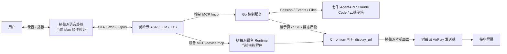

# 当前实现与树莓派目标架构

本文是当前仓库的实现基线，描述已经落地的模块规格、边界、数据流和分工。设计过程与后续 proposal 保留在 [Issue #6](https://github.com/wwcchh0123/hackathonGO-2026/issues/6)、[Issue #18](https://github.com/wwcchh0123/hackathonGO-2026/issues/18) 和 [Issue #25](https://github.com/wwcchh0123/hackathonGO-2026/issues/25)。接口字段和限制以 [协议文档](protocol.md) 为准。

## 范围

- **本期实现**：Mac 软件语音终端、Go 控制服务、设备展示模拟程序、AgentAPI/Claude Code 编程链路、事件与静态产物展示，以及只读设备管理页；这些软件组件按目标树莓派终端的职责拆分，先在 Mac 和模拟设备上验证。
- **目标硬件**：产品终端以 **Raspberry Pi（树莓派）** 为硬件基线。树莓派同时承担灵矽语音对话客户端、展示浏览器和 AirPlay 发送端；电视或其他大屏只作为 AirPlay 接收端。当前 `cmd/voice` 是 Mac 上的语音验证端，`cmd/device-display` 是树莓派设备侧的模拟实现。
- **硬件验收边界**：树莓派具体型号、麦克风/扬声器、ALSA/Opus 构建和 AirPlay sender 在目标设备上的兼容性仍需现场验证；协议、控制服务和设备 MCP 的职责已经按树莓派部署方式确定。

## 系统组成



语音终端、控制服务、设备展示是三个独立进程；目标部署中语音终端和设备展示进程运行在同一台树莓派上。大屏只显示树莓派发送的画面；编程在 AgentAPI 沙箱中执行。

## 模块规格与边界

| 模块 | 输入 | 输出/状态 | 负责的行为与不变量 |
| --- | --- | --- | --- |
| `cmd/control` | 环境变量、进程信号 | HTTP 服务、共享 provider、设备管理器 | 只做配置、依赖组装、启动和优雅退出；不写任务编排业务 |
| `cmd/voice` | 启动参数、`.data/voice` 身份 | 本机 `127.0.0.1:8090` | 组装树莓派语音进程的身份、语音桥和生命周期；当前 Mac 用于验证；灵矽设备 token 不进入浏览器、URL 或日志 |
| `cmd/device-display` | 设备配置、设备 MCP 调用 | 树莓派 Chromium、AirPlay sender、设备 MCP | 管理树莓派上的浏览器和 sender 子进程；当前提供模拟设备实现；只展示/操作当前网页，不调用 AgentAPI |
| `internal/linx` | 身份文件、OTA、灵矽 WSS | 设备身份、token、hello/音频协议状态 | 处理身份持久化、绑定、OTA 和协议协商；灵矽对话 ID 不当作 AgentAPI session id |
| `internal/voice`、`internal/voicecodec` | 浏览器 PCM、云端 Opus/文字事件 | 本地播放、字幕/人物快照、语音 WS | 单窗口录音/播报和 `abort`；`abort` 只停止播报，不中断编程任务；Opus 为可选原生依赖 |
| `internal/transport/mcp` | MCP JSON-RPC、Bearer 和设备/对话头 | 四个云端工具的 JSON 结果 | 负责编解码、身份提取和错误包装；不决定 Session 目标、不执行编程业务 |
| `internal/controlplane` | 已鉴权设备请求、只读管理查询 | 进程内设备注册表、每设备 controller、管理聚合 | 按 `device_id` 路由和隔离；`online` 只表示最近收到鉴权请求，不表示硬件心跳 |
| `internal/session` | 任务引用、用户需求、AgentAPI provider | 异步 receipt、command 状态、task/detail | 唯一编程控制入口；目标在入队时固定；修改遵循 `interrupt → authoritative idle → message`；不确定写入保留 `unknown` 且不自动重发 |
| `internal/agentapi` | 领域请求、SDK/HTTP 响应 | Session、Events、Files、Mock | 隔离上游协议和重试边界；不包含设备展示或 GitHub 编排逻辑 |
| `internal/events` | AgentAPI 原始事件 | 有界历史、实时唤醒、回放游标 | 保留原始 JSON 和未知字段；按事件 ID 去重；游标淘汰必须显式重新同步 |
| `internal/device`、`internal/progress` | 事件、查询结果 | 当前设备快照、一句话摘要 | 只做可解释的状态投影和消息摘录；不调用额外摘要模型 |
| `internal/artifacts` | AgentAPI 文件列表/内容 | 隔离静态发布目录、结果 URL | 校验相对路径、限制文件和磁盘规模；只托管静态产物，不代理任意后端端口 |
| `internal/transport/httpapi` | HTTP、WS、SSE、Cookie/Bearer | 控制台、管理页、展示页和预览接口 | 负责鉴权和 wire 编解码；业务决策委托给 `session`/`controlplane` |
| `internal/devicedisplay` | 嵌入页面资源、公开 task 引用 | 公共任务展示页、事件和产物视图 | 只读渲染任务过程与结果；公开展示不携带控制凭据 |
| `internal/devicecontrol`、`internal/devicecast` | 设备 MCP、浏览器/CDP、AirPlay 配置 | 设备工具结果、浏览器操作、sender 生命周期 | 提供七个设备工具（扫描、投屏、滚动、截图、DOM 检查、点击、停止）；不调用 AgentAPI，停止投屏不停止编程 |

`internal/transport/httpapi/devui` 是开发联调页面，`internal/voice/ui` 是用户语音终端，`internal/devicedisplay/web` 是大屏页面；三者用途不同。

## 三位成员分工

下表按当前仓库的提交记录和代码边界归纳；每项由主责人维护设计一致性、测试和交付，跨模块改动由主责人与相关协作者共同验收。

| 成员 | 主责模块 | 交付内容 | 验收与交接 |
| --- | --- | --- | --- |
| **姬长军** | 控制服务核心与控制面：`cmd/control`、`internal/config`、`internal/session`、`internal/agentapi`、`internal/events`、`internal/device`、`internal/progress`、`internal/artifacts`、`internal/transport/mcp`、`internal/transport/httpapi`、`internal/controlplane` | AgentAPI 适配、任务/命令生命周期、事件与产物、MCP/HTTP 契约、设备隔离、管理页、协议和 CI/覆盖率门槛 | 维护 Issue proposal、协议文档和核心 Go 测试；向王成提供稳定的云端工具/查询契约，向汪世胤提供展示页、SSE 和静态产物契约 |
| **王成** | 语音端与端到端产品联调：`cmd/voice`、`internal/linx`、`internal/voice`、`internal/voicecodec`，以及整体验收 | 树莓派目标语音端的灵矽身份/OTA/WSS、PCM/Opus、语音页面和人物联动；当前用 Mac 验证，负责真实语音、MCP、展示链路的演示编排 | 运行 `make voice-test voice-build` 和浏览器音频测试；验证灵矽云调用控制 MCP 的完整路径，向汪世胤提供设备唤醒/展示联动场景 |
| **汪世胤** | 设备展示和投屏：`cmd/device-display`、`internal/devicecontrol`、`internal/devicecast`、`internal/devicedisplay` 及浏览器/CDP 交互 | 树莓派设备 MCP、Chromium 生命周期、截图/DOM/iframe 检查、点击/滚动、AirPlay sender 和展示页面交互；当前用模拟设备验证 | 维护 device-display 测试、Chromium/iframe 集成和 sender/接收屏实测；消费姬长军的 `display_url`/SSE 契约，向王成回报语音人物页和投屏现场边界 |

共同规则：每项开发关联一个 GitHub Issue；接口变化同步 `docs/protocol.md` 和测试；报告中明确 Mock、真实 AgentAPI、浏览器、语音和物理 AirPlay 的证据边界。任何一人都可以修复跨模块问题，但必须由对应主责人确认契约和验收结果。

## 三条独立链路

1. **语音**：树莓派语音进程 → 灵矽 WSS → ASR/智能体/TTS → 树莓派本地播放。语音 `abort` 只停止播报。
2. **编程**：灵矽调用 `new_task` / `send_message` → 控制服务入队 → AgentAPI。新任务建独立 Session；修改运行中任务遵循 `interrupt → 查询确认 idle → 同 Session 发消息`。查询不改变默认发送目标。
3. **展示**：控制工具返回 `display_url` → 灵矽调用设备 `cast_screen` → 树莓派 Chromium 从控制服务获取页面/SSE → 预览导出产物 → 树莓派 AirPlay sender 镜像到大屏。切换或停止展示不停止编程。

## 引入的 MCP 工具

项目引入两套职责分离的 MCP 工具：**云端控制 MCP** 面向灵矽云智能体，负责把语音意图转换为 AgentAPI 任务操作；**设备展示 MCP** 面向灵矽设备，负责浏览器和投屏控制。设备展示 MCP 不持有 AgentAPI Key，也不直接调用 AgentAPI。

### 云端控制 MCP：`/mcp`

调用方向为“灵矽云 → Go 控制服务 → AgentAPI”。服务使用 Bearer `CONTROL_TOKEN` 鉴权，并通过 `X-Linx-Device-Id`、`X-Linx-Session-Id` 和 `X-Linx-Agent-Id` 识别设备与对话。当前对外收敛为四个工具：

| 工具 | 类型 | 作用 | 关键语义 |
| --- | --- | --- | --- |
| `list_tasks` | 只读查询 | 分页列出当前配置 Agent 的任务 | 返回状态、标题、时间和近期消息摘录；不改变后续发送目标 |
| `get_task` | 只读查询 | 查询指定 `task_ref` 的详情 | 返回云端状态、命令状态、停止原因、消息、有限事件和文件元信息；`events_limit=0` 可只查状态和消息 |
| `new_task` | 异步写入 | 创建独立 AgentAPI Session 并发送首条需求 | 返回 `task_ref`、`command_id` 和可选 `display_url`；`accepted` 只表示已受理，不表示任务完成 |
| `send_message` | 异步写入 | 向指定任务发送修改、继续或暂停需求 | 运行中先 `interrupt`，确认权威 `idle` 后再向同一 Session 发送；写入结果不确定时保留 `unknown`，不自动重发 |

`task_ref` 是控制服务生成的不透明短期引用，灵矽不需要理解真实 Session ID。新任务与续聊的发送目标在入队时固定；列表、详情和展示选择不会偷偷切换目标。配置 `PUBLIC_URL` 后，写入和详情结果可带 `display_url`，灵矽应把完整地址原样交给设备展示 MCP 的 `cast_screen`。

### 设备展示 MCP：设备侧 `/device/mcp`

调用方向为“灵矽云 → 设备 MCP → Chromium/AirPlay”。部署时可以通过反向代理挂在 `/device/mcp`，设备进程内部 handler 使用 `/mcp`。工具只操作设备本地展示状态：

| 工具 | 作用 | 边界 |
| --- | --- | --- |
| `scan_screens` | 扫描局域网投屏目标 | 只返回可用屏幕，不启动任务 |
| `cast_screen` | 打开 `display_url` 并开始 AirPlay 镜像 | 只切换展示页面，不创建或修改 AgentAPI Session |
| `scroll_screen` | 滚动当前投屏页面 | 只改变浏览器滚动位置 |
| `capture_screen` | 返回当前截图和页面结构 | 截图与 DOM/iframe 信息用于观察；没有截图不能报告展示成功 |
| `inspect_browser` | 读取当前页面及 iframe 的可见文本、元素和 HTML | 返回的 `element_id` 只在最近一次观察有效 |
| `click_browser` | 点击最近观察返回的真实元素 | 点击回执只表示已发出点击，仍需再次观察确认作品变化 |
| `stop_cast` | 停止浏览器/AirPlay 投屏 | 只停止展示，不停止云端编程任务 |

### 两套 MCP 的协作顺序

```text
new_task / send_message
  → 控制 MCP 返回 task_ref、command_id、display_url
  → 灵矽调用设备 MCP.cast_screen(display_url)
  → 设备浏览器打开展示页并订阅控制服务 SSE
  → 需要交互时 capture_screen 或 inspect_browser → click_browser / scroll_screen
  → stop_cast 只关闭展示链路
```

两套 MCP 的连接生命周期互不承担任务状态：MCP 断线不会取消 AgentAPI Session，设备切换页面不会改变消息发送目标。完整参数、分页、鉴权、错误和兼容传输见 [协议文档](protocol.md)。

## 静态产物与凭据

Agent 在沙箱构建作品并导出至 `/mnt/session/outputs/`。控制服务按需读取当前 Session 的全部 Files 产物，按返回的相对路径同步到同一份发布目录；预览入口优先是根目录 `index.html`，入口引用的 CSS、JavaScript、图片和子目录资源会从该目录提供。同步仍限制文件数、大小与时间，只托管静态产物。预览容器中的作品使用隔离 iframe 和受限本地存储，不能读取控制凭据或访问外部 API。

AgentAPI Key 仅在控制服务。CONTROL_TOKEN 与上游 Key 分开；浏览器控制接口使用 HttpOnly Cookie，MCP 使用 Bearer。灵矽设备 token 仅在语音 Go 进程内。设备展示页和只读任务索引公开，不应用于敏感任务展示；部署暴露范围见 [部署指南](deploy.md)。

完整接口、限制和配置以 [协议文档](protocol.md) 为准；验收记录和未完成项见 [Issue #25](https://github.com/wwcchh0123/hackathonGO-2026/issues/25)。
