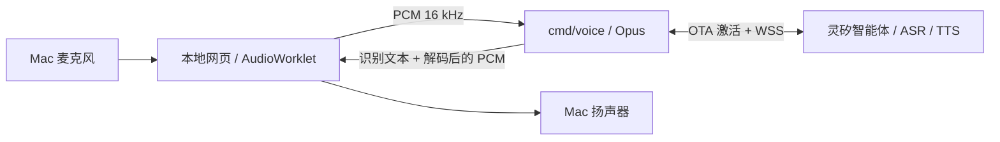

# Mac 软件语音终端

本终端把 Mac 作为一台灵矽软件设备：浏览器负责录音/播放，独立 Go 进程负责设备身份、激活、Opus 和灵矽连接。语音识别、模型和语音合成均由你绑定的灵矽智能体提供。

安装环境、启动参数、停止重启和日常排错，见 [Mac 语音客户端启动指南](voice-startup.md)。

从设备绑定到每轮录音、回复、断开重连的完整过程，见 [当前语音连接的整体逻辑](voice-connection-flow.md)。



## 启动与绑定

要求 Go 1.26+、Homebrew 的 opus/pkgconf，以及支持 AudioWorklet 的浏览器。Mac 上优先用 Chrome；浏览器需要允许该本地页面使用麦克风。

```sh
brew install opus pkgconf
make voice
```

1. 打开 `http://127.0.0.1:8090`。
2. 首次启动显示六位激活码；登录 [灵矽智控台](https://xrobo.qiniu.com/)，在目标智能体下添加对应设备。模型、音色和角色使用该智能体的现有配置。
3. 本地每 5 秒检查绑定状态，约每分钟刷新激活码；绑定完成后自动更新页面。
4. 点击「连接智能体」。显示「已连接」后点击「开始说话」，允许麦克风；说完点击「说完了，发送」。每次最长 60 秒，切换到后台会停止并发送。
5. 查看识别文字，听语音回复。「停止播报」清空播放队列；继续说话也会打断当前回复。
6. 连接断开后点击「重新连接」。每次连接重新获取设备 token；不会重放上次的录音。

已经绑定的设备再次运行只需要 `make voice`。也可以先构建再启动：

```sh
make voice-build
./bin/voice -listen 127.0.0.1:8090 -data-dir .data/voice
```

只激活设备、不安装音频依赖时：

```sh
go run ./cmd/voice -pair-only
```

## 身份与凭据

首次启动随机生成本地管理的伪 MAC 地址与 UUID v4，原子保存到 `.data/voice/identity.json`（权限 0600）。不会读取或修改 Mac 的物理网卡地址。重启、更换代码版本会继续使用同一身份；损坏的身份文件会报错，不会悄悄生成新设备。该目录已被 Git 忽略。

设备绑定关联这份身份。不要为排错删除它；更换目录相当于创建另一台设备，需要重新绑定。激活使用 Activation-Version 1；OTA 响应中的固件升级信息对本软件终端无效，不会下载或安装硬件固件。

设备 token 从 OTA 获取，仅在 Go 内存中使用。日志和本地页面不包含 token，客户端也不需要 AgentAPI Key。生产灵矽连接使用 WSS；OTA 返回 ws 时保留地址的主机/路径并升级到 wss，不回退明文。默认 OTA 为官方 `https://xrobo.qiniuapi.com/v1/ota/`。

本地服务只允许 loopback，不支持把 8090 暴露到局域网或公网。一台设备一次只接收一个语音页面，关闭其他窗口或先断开已有连接后再试。

## 与 issue #6 的关系

当前实现的是设备语音连接。控制服务仍是 `cmd/control`，默认独立监听 8080，可由灵矽云端 MCP 调用。语音客户端没有本地 Claude Code 进程，不处理编程权限或执行命令；真实编程需另外配置 AgentAPI，默认 Mock 只模拟开发过程。

接编程工具时，把控制服务的 `DEVICE_ID` 配成这里显示的 `device_id`，在灵矽配置控制 MCP `/mcp` 和设备 MCP `/device/mcp`，并关联智能体。服务同时支持 Streamable HTTP 和旧版 SSE，详见 [MCP 协议与配置](protocol.md#云端-mcp)。灵矽对话 session_id 与 AgentAPI session_id/task_ref 是三套不同的标识。控制 MCP 返回 `display_url` 后，智能体把它原样交给设备 MCP 的 `cast_screen`；设备浏览器渲染展示页并通过 AirPlay 镜像。

## 验证

```sh
make check test build
make voice-test
node --test internal/voice/test/pcm.test.mjs
```

默认控制服务测试不依赖 libopus。语音测试额外启用 `opus` 构建标签，覆盖真实编码/解码与 16/24 kHz 输出；其他测试使用本地 HTTP/WebSocket 假上游，覆盖激活码 → 绑定 → 获取 token、握手鉴权、hello 超时、完整语音桥、停止播报后丢弃旧音频、关闭页面取消激活、跨站请求和双窗口限制。浏览器重采样测试覆盖 16/44.1/48/96 kHz、跨回调连续性、PCM16 裁剪与末帧补零。Node 只用于这项测试，不参与应用运行或构建。

ASR/TTS、控制 MCP、设备 MCP 和本地浏览器渲染分别已有真实联调记录；完整语音任务链路必须以当前智控台账号重新连接后复验。控制 MCP 的 Bearer 令牌必须与本地 `CONTROL_TOKEN` 完全一致，角色配置保存后也必须断开并重新连接语音设备。AirPlay 接收端若离线，不能把 sender 重试误报为屏幕已显示。绑定身份和凭据均不入库。

## 常见问题

| 现象 | 处理 |
| --- | --- |
| `pkg-config` 找不到 opus | 运行 `brew install opus pkgconf`，确认 Homebrew 的 bin 在 PATH 中 |
| 提示音频模块未启用 | 使用 `make voice` 或 `make voice-build`；普通 `go run ./cmd/voice` 不启用原生 Opus |
| 一直等待绑定 | 确认添加的是当前激活码，并且添加在要使用的智能体下；保留原 identity.json |
| 绑定完成但连接失败 | 确认设备已选择智能体，账号的模型/语音配置可用；重新连接会刷新 token |
| 无法录音 | 允许浏览器网站麦克风权限，检查 macOS 的麦克风权限与输入设备，使用 localhost / 127.0.0.1 页面 |
| 有识别文字但无回复 | 检查智能体模型配置和额度；如果开启了「仅回应已添加说话人」，需录入声纹或关闭该限制后重新连接 |
| 有文字却听不到声音 | 检查系统输出设备/音量；点击连接会启用浏览器播放，播放中避免将页面挂起 |
| 修改角色后未生效 | 点击断开再重新连接；配置更新通知只提示重连，不中断当前会话 |
| 停止播报后编程任务还在运行 | 这是预期行为：语音 abort 只停止 TTS；编程暂停意图通过云端 MCP 的 send_message 原话转交，由控制服务处理会话 |

协议来源：[OTA 网关](https://linx.qiniu.com/docs/xrobot/platform/OTA)、[WebSocket 与音频](https://linx.qiniu.com/docs/xrobot/platform/websocket)、[设备绑定](https://linx.qiniu.com/docs/xrobot/guide/quick-start)。

## 多任务工具迁移（Issue #18）

控制服务升级后，在灵矽管理端重新发现并保存控制 MCP 的 `list_tasks/get_task/send_message/new_task` 和设备 MCP 的 `cast_screen/scroll_screen/stop_cast/scan_screens`，替换旧工具，提示词使用 [协议文档](protocol.md#灵矽配置与部署)。新回执含任务引用和命令编号，Agent 应读取 JSON 字段后简短转述；查询结果和旧消息摘录不作为本轮完成证明。工具失败或 unknown 时先查询，不自动重复提交。

Mac 语音桥只处理身份、音频和语音事件；云端 Agent 通过控制 MCP 创建、查询或继续任务，再把 `display_url` 交给独立设备 MCP 的 `cast_screen`。任务展示页支持多 Session，切换展示不改变消息发送目标。修改角色或 MCP 配置后，必须重新连接语音设备，不能用旧连接的工具缓存判断新配置是否生效。
