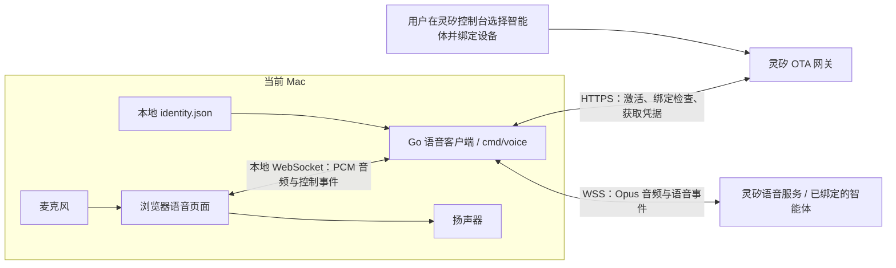
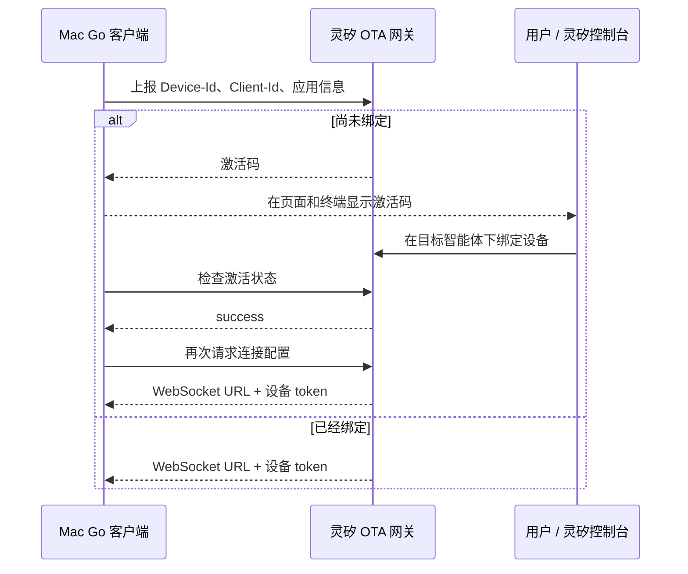
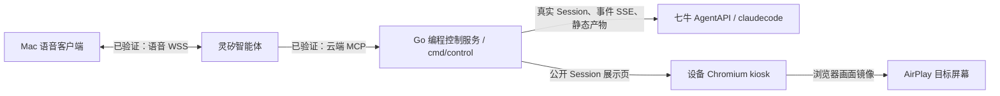

# 当前语音连接的整体逻辑

本文对应 2026-10-25 的实现，说明从启动 Mac 客户端到听见灵矽回复、启动 AgentAPI 任务并投屏的实际过程。安装和操作步骤见 [语音客户端说明](voice-client.md)，接口字段见 [接口协议](protocol.md)。

Mac 上的浏览器页面和 `cmd/voice` Go 进程共同组成一台软件设备：页面提供麦克风、扬声器和按钮；Go 进程提供设备身份、连接协议和音频编解码；灵矽云端运行绑定的智能体，完成语音识别、理解和语音合成。



**1. 启动：先确定“我是哪台设备”**

运行 `make voice`，构建并启动 `cmd/voice`。程序读取 `.data/voice/identity.json`；首次运行没有这个文件时，生成两个标识并保存：

| 标识 | 作用 | 生命周期 |
| --- | --- | --- |
| `Device-Id` | 让灵矽识别这台软件设备，并找到设备绑定关系 | 保留身份文件时跨重启不变 |
| `Client-Id` | 标识这个软件客户端实例，格式为 UUID v4 | 同样保存在身份文件中 |

Device-Id 是随机生成的本地管理伪 MAC 地址，无需真实硬件的物理网卡地址。更换身份目录等同于使用另一台软件设备，需要重新绑定。

Go 同时在 `127.0.0.1:8090` 提供网页和本地接口。启动程序只会先检查设备绑定，不会立即开启麦克风，也不会立即建立云端语音 WebSocket。

对应代码：[`cmd/voice/main.go`](../cmd/voice/main.go)、[`internal/linx/identity.go`](../internal/linx/identity.go)。

**2. 激活：把“这台设备”关联到“你的智能体”**

Go 向官方 OTA 网关发送设备信息：

```text
POST https://xrobo.qiniuapi.com/v1/ota/

Activation-Version: 1
Device-Id: <本地持久化设备 ID>
Client-Id: <本地持久化 UUID>
```

请求体同时包含匹配的设备 ID、客户端 UUID、应用版本、程序哈希和软件设备类型。此处 OTA 承担设备接入入口的职责；客户端不会安装其响应中的硬件固件。

未绑定时，网关返回激活码。用户在灵矽控制台进入目标智能体，使用该激活码添加设备。Go 每 5 秒检查一次激活结果，等待约一分钟后会重新请求 OTA 来刷新激活信息。

绑定成功后，再请求 OTA，获得语音 WebSocket 地址和设备 token。已经绑定过的设备会直接获得这些连接凭据，正常重启无需再次输入激活码。



**连接哪个灵矽智能体，由控制台的设备绑定关系决定。** 当前语音程序不配置灵矽 agent ID，也不上传角色提示词。灵矽根据设备身份应用对应智能体的角色、模型、音色等配置。仓库中控制服务使用的 `AGENTAPI_AGENT_ID` 则属于后续编程执行链路，含义不同。

网页通过 `GET /api/status` 获取绑定状态；没有语音连接时约每 3 秒查询一次。显示“设备已绑定”仅说明绑定准备完成。

对应代码：[`internal/linx/ota.go`](../internal/linx/ota.go) 的 `Pair`、`Fetch`、`Activated`，以及 [`internal/voice/server.go`](../internal/voice/server.go) 的 `Pair`。

**3. 点击连接：建立两段独立的 WebSocket**

用户点击「连接智能体」后，依次发生：

1. 页面启用浏览器音频播放环境，连接本地 `ws://127.0.0.1:8090/api/voice`。
2. Go 再次请求 OTA，获取本次连接使用的设备 token 和服务地址。启动时已完成绑定，也会在这里重新获取凭据。
3. Go 使用返回的地址连接灵矽 WSS；返回地址为 ws 时升级为 wss，保留主机和路径。
4. Go 在云端握手请求头中携带 `Authorization: Bearer <设备 token>`、`Device-Id`、`Client-Id` 和 `Protocol-Version: 1`。
5. Go 发送 hello，声明输入音频为 Opus、16 kHz、单声道、60 ms 一帧。
6. 灵矽返回 hello、可选的语音 session_id 和输出音频参数；Go 按返回的采样率建立解码器，并向页面发送 ready。

页面收到 ready 后才显示“已连接”，并允许开始录音。云端连接及 hello 握手默认最多等待 10 秒。

| 连接 | 发起方 | 用途 |
| --- | --- | --- |
| 浏览器 → 本地 Go 的 WebSocket | 页面 | 传录音 PCM、按钮操作、识别文字、解码后的回复音频 |
| Go → 灵矽的 WSS | Go 客户端 | 设备鉴权、hello、Opus 音频、listen / abort / STT / TTS 事件 |

浏览器不直接连接灵矽，也不接触设备 token。Go 对本地连接校验 Host 和 Origin，并限制一个客户端进程同一时间只接受一个语音窗口。

对应代码：[`internal/voice/ui/app.js`](../internal/voice/ui/app.js) 的 `connect`、[`internal/voice/server.go`](../internal/voice/server.go) 的 `handleVoice` / `bridge`、[`internal/linx/websocket.go`](../internal/linx/websocket.go) 的 `Connect`。

**4. 开始说话：边录音，边上传音频**

点击「开始说话」后，页面请求浏览器麦克风权限，清空旧的播放队列。它向 Go 发送 start；Go 先发送语音 abort，再发送 `listen.start`，使用 `manual` 模式。

录音随后沿这条路径连续传输：

```text
Mac 麦克风
  → 浏览器 getUserMedia 采集
  → AudioWorklet 连续重采样到 16 kHz
  → 每帧 960 个采样点，转换为单声道 PCM16LE（1920 字节 / 60 ms）
  → 本地 WebSocket 发送给 Go
  → Go 用 libopus 编码
  → 云端 WSS 以二进制音频帧发送给灵矽
```

浏览器请求回声消除、降噪、自动增益，并对音频做低通滤波后送入重采样器。Go 不调用本地语音识别或大模型。

**录音期间音频已经实时上传。**「说完了，发送」的实际作用是结束这一轮输入：页面先补齐并发送末帧，再发送 stop；Go 将它转换为 `listen.stop`，随后页面释放麦克风。单次录音最长 60 秒，切换到后台也会停止并发送。

对应代码：[`internal/voice/ui/app.js`](../internal/voice/ui/app.js) 的 `start` / `stop`、[`mic-worklet.js`](../internal/voice/ui/mic-worklet.js)、[`pcm.mjs`](../internal/voice/ui/pcm.mjs)、[`internal/voice/server.go`](../internal/voice/server.go) 的 `upload`、[`internal/voicecodec/opus.go`](../internal/voicecodec/opus.go)。

**5. 灵矽回复：返回文字和音频，两者分别处理**

灵矽云端负责识别用户语音，使用绑定智能体的模型和角色生成回复，再合成语音。客户端接收这些结果：

| 下行内容 | Go 和页面如何处理 |
| --- | --- |
| `stt.text` | 转发给页面，作为“你”的识别文字 |
| `tts.start` | 重置回复音频解码器，页面进入播报状态 |
| `tts.sentence_start.text` | 转发给页面，作为“灵矽”的回复文字 |
| Opus 二进制音频 | Go 按 hello 返回的采样率解码为 PCM，页面使用 Web Audio 排队播放 |
| `tts.stop` | 正常结束时播放完已排队的音频，再回到等待说话状态 |
| `tts.stop` 且 `is_aborted=true` | 立即清空播放队列 |

回复采样率取决于服务端协商，不能固定认为与麦克风输入相同。客户端按收到的实际音频样本数安排播放；页面上展示的回复文字来自 TTS 句子事件。

一轮说完以后，两段 WebSocket 可以继续复用；下一次点击录音，在同一个仍有效的灵矽语音会话里继续对话。

**6. 打断、断开和重新连接**

| 操作或事件 | 当前行为 |
| --- | --- |
| 点击「停止播报」 | 页面清空播放队列，Go 向灵矽发送 abort，并丢弃旧回复音频 |
| 回复过程中再次开始说话 | 清空旧播放、发送 abort 和 listen.start，转入新一轮录音 |
| 录音期间收到旧 TTS | 丢弃，避免旧回复与新录音混在一起 |
| 关闭页面或点击断开 | 停止录音和播放，释放麦克风，关闭该页面对应的云端连接 |
| 灵矽发送 goodbye | 当作本次语音会话正常结束，显示可重新连接 |
| 网络中断或心跳失败 | 结束当前连接，提示用户重新连接 |
| 点击「重新连接」 | 复用设备身份，重新获取 token，重新完成 hello；不补发上次录音 |
| 收到智能体配置更新通知 | 提示用户断开后重连，使新配置生效 |

Go 每 25 秒发送一次云端 WebSocket Ping；传输心跳不会阻止云端按业务规则结束空闲会话。当前使用手动分轮交互，尚未实现持续免按键的自由对话。重新连接可能获得新的灵矽 session_id，客户端不保证恢复之前的云端对话上下文。

语音 abort 只影响语音通道。按 issue #8 的最新 MCP 协议，编程暂停意图通过 `send_message` 原话转交，由控制服务处理会话；已不再提供独立的 MCP interrupt 工具。语音停止播报和编程暂停不能相互替代。

**7. 这条语音连接与编程、投屏如何衔接**

当前已验证从真实语音到 AgentAPI 和设备投屏的完整链路。独立的 `cmd/control` 默认监听 8080，联调时可通过 `LISTEN_ADDR` 覆盖；8090 语音页面仍只负责语音收发，编程事件通过设备浏览器打开控制服务提供的公开 Session 展示页。

当前链路如下：



设备身份是语音链路和编程控制链路的关联点：把控制服务 `DEVICE_ID` 配为软件设备的 Device-Id，并与灵矽云端 MCP 带入的 `X-Linx-Device-Id` 匹配。网页体验端的虚拟设备 ID 与它不同，可以列出工具，但默认不能调用工具。不要用灵矽语音 session_id 代替 AgentAPI 的编程 session_id。

客户端不会启动本地 Claude Code，也不持有 AgentAPI 凭据。默认 Mock 下的开发进度和番茄钟产物是模拟内容；配置 HTTP Provider 后由控制服务真实创建 AgentAPI Session。角色提示词只负责规定灵汐云如何在控制 MCP 与设备 MCP 之间编排，设备 MCP 自己只打开网页和管理 AirPlay。

**8. 阅读代码的顺序**

| 文件 | 负责的问题 |
| --- | --- |
| [`cmd/voice/main.go`](../cmd/voice/main.go) | 程序如何启动、读取身份、启动配对和 HTTP 服务 |
| [`internal/linx/identity.go`](../internal/linx/identity.go) | 设备 ID 与客户端 UUID 如何生成和持久化 |
| [`internal/linx/ota.go`](../internal/linx/ota.go) | 如何申请激活码、等待绑定、获取连接凭据 |
| [`internal/linx/websocket.go`](../internal/linx/websocket.go) | 如何鉴权连接、交换 hello、记录语音 session_id |
| [`internal/voice/server.go`](../internal/voice/server.go) | 如何连接浏览器与灵矽、转发事件、处理生命周期 |
| [`internal/voice/ui/app.js`](../internal/voice/ui/app.js) | 按钮、录音、播放和页面状态如何工作 |
| [`internal/voice/ui/mic-worklet.js`](../internal/voice/ui/mic-worklet.js) / [`pcm.mjs`](../internal/voice/ui/pcm.mjs) | 麦克风采样如何变成连续的 PCM 帧 |
| [`internal/voicecodec/opus.go`](../internal/voicecodec/opus.go) | PCM 和 Opus 如何相互转换 |
